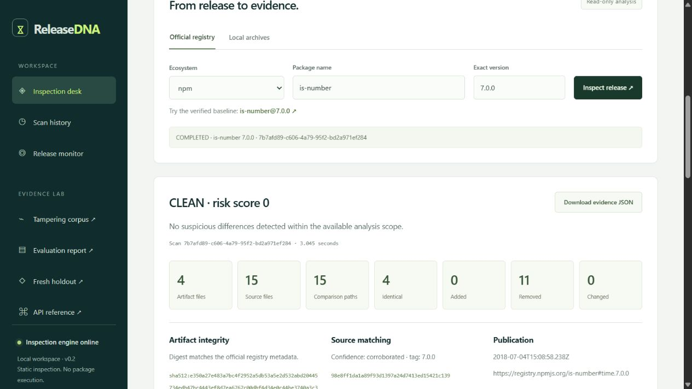
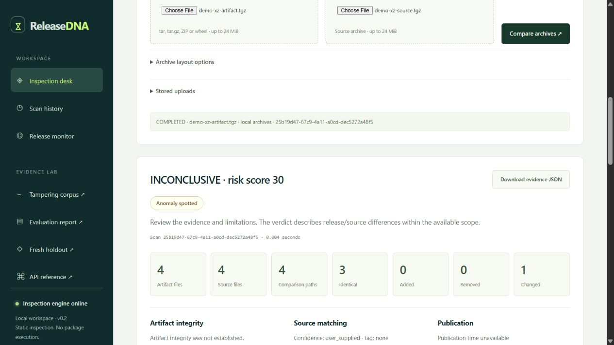
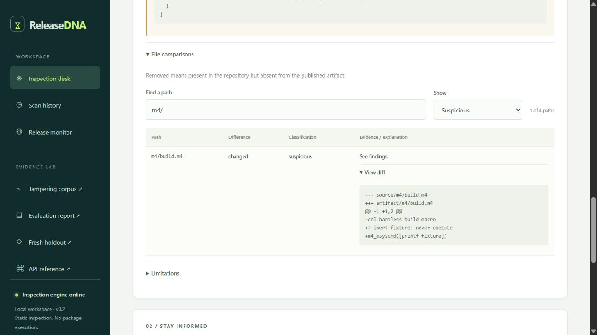

# First run and five-minute evidence demo

This guide was prepared with AI assistance and replayed on Windows with Python 3.13.1 on 19 November 2026, against detector commit `3a93ae3d5b0cd7ee6fe51f5f248ac1981d142a80`. These are maintainer-side observations, not tests attributed to a future PR contributor. A contributor should review and replay the guide before submission.

## 1. Start from a fresh checkout

Install Python 3.11+ and Git, then open PowerShell. The pinned dependency install needs internet access. Official scans also need access to npm and GitHub. No npm install or AI key is required.

```powershell
git clone https://github.com/AbhiDream/releasedna.git
Set-Location releasedna/releasedna
python --version
python -m venv .venv
.\.venv\Scripts\python.exe -m pip install -r requirements-lock.txt
.\.venv\Scripts\python.exe -m pip check
Set-Location backend
..\.venv\Scripts\python.exe -m unittest discover -s tests -v
..\.venv\Scripts\python.exe -m app.adversarial_corpus
..\.venv\Scripts\python.exe -m uvicorn app.api.main:app --host 127.0.0.1 --port 8000
```

The outer `releasedna` directory is the Git checkout; the inner one contains `requirements-lock.txt` and `backend`. Existing contributors can enter that inner directory instead of cloning again. When reviewing this contribution before merge, select its branch in your checkout first.

Keep the server terminal open. Visit [the frontend](http://127.0.0.1:8000/) in a browser. Swagger at `/docs` is optional; this demo uses the actual frontend. The corpus command creates harmless text fixtures under `releasedna/data/`. It inspects the strings without running their contents. Dependency installation installs ReleaseDNA's own dependencies only.

Use one API process. Keep it bound to localhost; this prototype has no public-service authentication. The replay used port **8001**, because a separate existing instance already occupied 8000. If changing ports, use the same port in your browser and commands. Do not run two processes against the same database.

## 2. Inspect a real public release — about two minutes

1. Select **Official registry**.
2. Choose **npm**, package **is-number**, exact version **7.0.0**.
3. Click **Inspect release** and wait for the job to complete.
4. Read the verdict, file counts, digest, source confidence and publication time separately.
5. Click **Download evidence JSON** and open the saved file.

Observed result for scan `7b7afd89-c606-4a79-95f2-bd2a971ef284`:

| Field | Measured value |
| --- | --- |
| Job state / verdict / score | completed / CLEAN / 0 |
| Artifact files / source files | 4 / 15 |
| Unique comparison paths | 15 |
| Identical / added / removed / changed | 4 / 0 / 11 / 0 |
| Registry digest | Verified SHA-512 |
| Source confidence | corroborated; tag `7.0.0` |
| Source commit | `98e8ff1da1a89f93d1397a24d7413ed15421c139` |
| Publication time | `2018-07-04T15:08:58.238Z` |

The legacy `total_files_inspected` is 19 because it adds 4 artifact instances and 15 source instances. The same path on both sides counts twice there, but once in the comparison table. **Removed** means repository-only; examine each omission explanation rather than treating all omissions as harmless.



Say: **“No suspicious differences detected within the available analysis scope.”** Do not say malware-free. The digest establishes agreement with registry metadata, source matching corroborates a revision, and neither verifies build provenance. A future run can differ if external metadata or source availability changes.

## 3. Show an exact tampered non-code difference — about two minutes

1. Select **Local archives**.
2. Choose `releasedna/data/demo-xz-artifact.tgz` for the artifact.
3. Choose `releasedna/data/demo-xz-source.tgz` for the source.
4. Leave the default archive layout controls and click **Compare archives**.
5. Open the findings, search file paths for `m4/`, choose **Suspicious**, and expand **View diff**.

Observed scan `25b19d47-67c9-4a11-a0cd-dec5272a48f5` completed with **INCONCLUSIVE / score 30**, an **Anomaly spotted** badge, 4 files on each side, 3 identical and 1 changed. Finding `SHELL_PIPELINE` points to `m4/build.m4`, line 2, where an inert fixture adds `m4_esyscmd([printf fixture])`. The unified diff displays the original macro and the added text.





This is an xz-style synthetic demonstration, not a real xz malware sample. Do not execute the fixture. **INCONCLUSIVE is expected for local uploads:** source identity is user-supplied and registry integrity is unverified. An uncertain verdict can still contain a scored anomaly. The demo proves this rule detected this modification; it does not prove universal detection.

The optional Groq explanation button remains disabled when no key is configured. Deterministic analysis and evidence downloads still work. Model narration, when configured, cannot change the frozen score.

## 4. Check persistence — about one minute

Download both evidence reports. Stop the server with `Ctrl+C`, start it again with the same command, refresh the browser, then select **Scan history → View** for each job. Use the existing database; do not delete `releasedna/data/scans.sqlite3`.

For an exact saved-report comparison, substitute your downloaded filename and scan ID:

```powershell
$job = Invoke-RestMethod 'http://127.0.0.1:8000/api/scans/YOUR-SCAN-ID'
$job.state
$job.result.status
```

In the measured replay, both completed jobs survived process termination and restart. Their entire API responses matched after normalizing the time-zone serialization performed by PowerShell (the instants were unchanged). Both frontend JSON downloads equalled the corresponding API `result` objects. The official scan was reopened through frontend history after restart.

## Verification record

| Check performed on 19 November 2026 | Result |
| --- | --- |
| New isolated virtual environment; pinned dependency install | PASS |
| `pip check` | PASS |
| Backend unit tests at base revision | PASS — 86 tests, 4.307 seconds |
| `node --check releasedna/frontend/app.js` from repository root | PASS |
| Official npm scan through frontend | PASS — measured values above |
| Local fixture upload, comparison, path filter and diff | PASS |
| Two frontend evidence downloads compared with API results | PASS |
| Completed results survive backend restart | PASS |
| Live model narration | NOT TESTED — no API key configured |
| Docker deployment | NOT TESTED — Docker unavailable |
| Friend's own machine replay | PENDING — contributor must record their own result |

The test count is specific to the base revision. Another corpus contribution adds five harness tests, so a later checkout may report 91. Passing unit tests does not mean every evaluation fixture is detected; see the separate evaluation reports for misses and false positives.

## Troubleshooting

The occupied port was observed during this replay. The other entries below are guidance, not claims that those failures occurred here.

| Symptom | Action |
| --- | --- |
| Address already in use | Stop your previous instance, or use another port; avoid a second worker on the same SQLite database. |
| Cannot find requirements or `app` | Run dependency commands in the inner `releasedna` folder and module commands in its `backend` folder. |
| PowerShell activation is blocked | Use the explicit `.venv\Scripts\python.exe` paths above; activation is unnecessary. |
| Registry/source scan fails | Read the persisted error. Check network access and exact version; do not relabel failure as CLEAN. |
| Local demo is INCONCLUSIVE | Expected: uploaded source identity is unverified. Inspect score, finding and exact diff. |
| Reports disappear | Check `RELEASEDNA_DB` and your checkout. Different checkouts have separate default data directories. |
| Download appears missing | Check the browser's Downloads list and permit the download if prompted. |

For architecture, limitations and other commands, see the [project README](../README.md). For contributor PR steps, see [CONTRIBUTING.md](../CONTRIBUTING.md).
